<h1 align="center">hdslave Synths &amp; Drum Machines (macOS &amp; Windows CLAP)</h1>

<p align="center"><strong>Hub repository for the desktop CLAP builds of all 11 hdslave synthesizers, drum machines, and effects — for FL Studio (2024+) and any other macOS / Windows CLAP host.</strong></p>

Each instrument and effect lives in its own dedicated repository alongside its Akai MPC Sample version (under each repo's `mac-clap/` directory) and is pinned here as a git submodule so a single clone fetches the entire desktop suite.

```sh
git clone --recurse-submodules https://github.com/hdslave/hdslave-Synths-and-drum-machines-Mac-Win.git
```

<sub>Already cloned without <code>--recurse-submodules</code>? Run <code>git submodule update --init</code> inside the folder.</sub>

> **Looking for the Akai MPC Sample versions &amp; hdslaveOS?** See the companion MPC Sample hub at [**hdslave-MPCSample-Synths-and-Drum-Machines**](https://github.com/hdslave/hdslave-MPCSample-Synths-and-Drum-Machines) and [**hdslaveOS**](https://github.com/hdslave/hdslaveOS). Releases on the individual repositories remain MPC Sample-only for now while the desktop builds are being finalized.

---

## Desktop CLAP Highlights

- **All MPC Screens on One Panel:** every plug-in renders all of its native hardware screens simultaneously in a resizable Retina/HiDPI multi-screen dashboard (with the hardware `K1`–`K3` footer panels removed), plus a **`ZOOM`** toggle for any individual screen.
- **Direct Mouse, Trackpad &amp; Touch Control:** click, drag (`Shift`+drag for fine control), scroll, double-click to reset, or right-click any parameter cell, list row, 2D X/Y pad, 3D morphing cube, step sequencer bar, punch-card bit, rhythm wheel, or audition pad directly inside any screen.
- **Built-in MIDI Learn &amp; DAW Integration:** bind hardware MIDI CCs via **MIDI LEARN** or right-click (saved in DAW project state), browse factory presets from the header bar, and automate every parameter natively in FL Studio and other CLAP hosts.
- **Native Zero-Bloat Backends:** Cocoa (`NSView` + CoreGraphics) on macOS and Win32 (`HWND` + `StretchDIBits`) on Windows x64.

---

## Synthesizers

<table>
  <tr>
    <td width="400" align="center">
      <a href="https://github.com/hdslave/TB-MPC-3-P-0-Synthesizer/tree/main/mac-clap">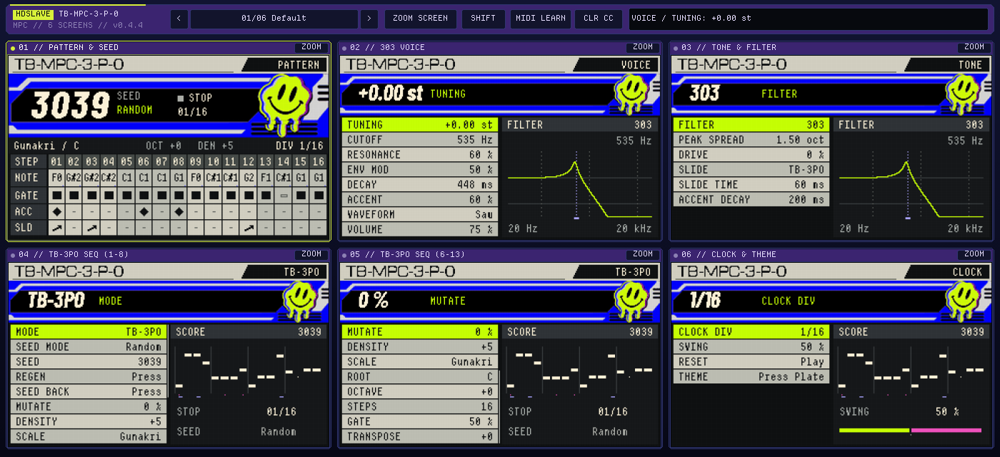</a>
    </td>
    <td>
      <h3><a href="https://github.com/hdslave/TB-MPC-3-P-0-Synthesizer">TB-MPC-3-P-0</a> &middot; <a href="https://github.com/hdslave/TB-MPC-3-P-0-Synthesizer/tree/main/mac-clap"><code>mac-clap/</code></a></h3>
      <p><strong>303-style acid bass synthesizer + TB-3PO generative sequencer (6 screens, 30 params).</strong></p>
      <p>Shows Pattern &amp; Seed, 303 Voice, Tone &amp; Filter, all 13 TB-3PO sequencer controls, and Clock &amp; Theme (Press Plate / Blacklight Transfer) simultaneously with 2D filter response dragging and direct acid smiley Regen.</p>
    </td>
  </tr>
  <tr>
    <td width="400" align="center">
      <a href="https://github.com/hdslave/hdslave-Psychic-Synth/tree/main/mac-clap">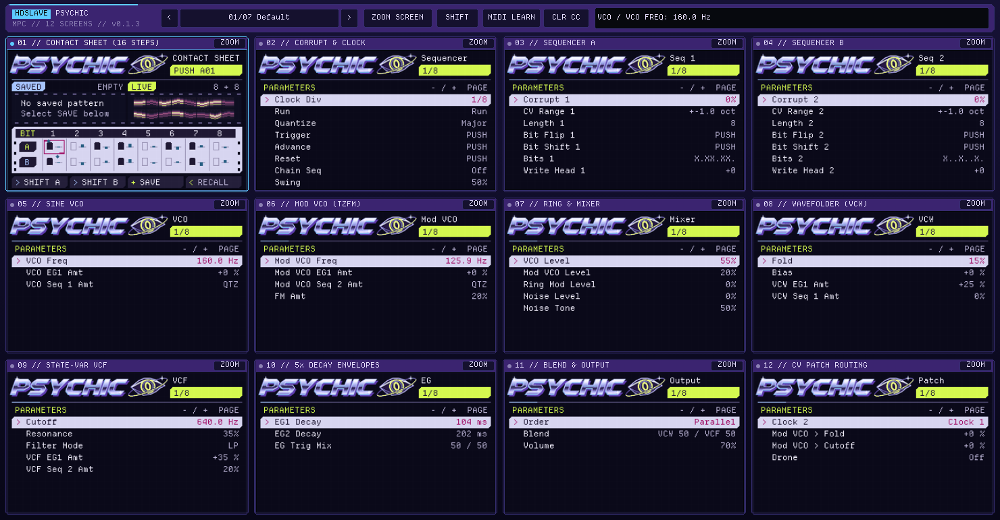</a>
    </td>
    <td>
      <h3><a href="https://github.com/hdslave/hdslave-Psychic-Synth">Psychic</a> &middot; <a href="https://github.com/hdslave/hdslave-Psychic-Synth/tree/main/mac-clap"><code>mac-clap/</code></a></h3>
      <p><strong>Generative analog-style dual-sequencer synth (12 screens, 71 params).</strong></p>
      <p>Displays the live Contact Sheet with click/paint 2&times;8 punch-card bit holes, bipolar voltage rulers, and Shift/Save/Recall buttons alongside every Corrupt, Sequencer, VCO, Mod VCO, Mixer, Wavefolder, VCF, EG, Output, and Patch page.</p>
    </td>
  </tr>
  <tr>
    <td width="400" align="center">
      <a href="https://github.com/hdslave/hdslave-Machine/tree/main/mac-clap">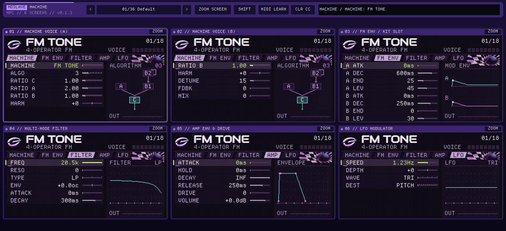</a>
    </td>
    <td>
      <h3><a href="https://github.com/hdslave/hdslave-Machine">Machine</a> &middot; <a href="https://github.com/hdslave/hdslave-Machine/tree/main/mac-clap"><code>mac-clap/</code></a></h3>
      <p><strong>18-engine multi-machine synth &amp; 8-slot drum kit (6 screens, 139 params).</strong></p>
      <p>Displays Machine Voice pages with live FM algorithm diagrams, FM Envelopes / Kit Slot selector, Multi-Mode Filter, Amp Env &amp; Drive, and LFO Modulator simultaneously with 2D context plot dragging and live scope auditioning.</p>
    </td>
  </tr>
  <tr>
    <td width="400" align="center">
      <a href="https://github.com/hdslave/hdslave-Nexus-Synth/tree/main/mac-clap">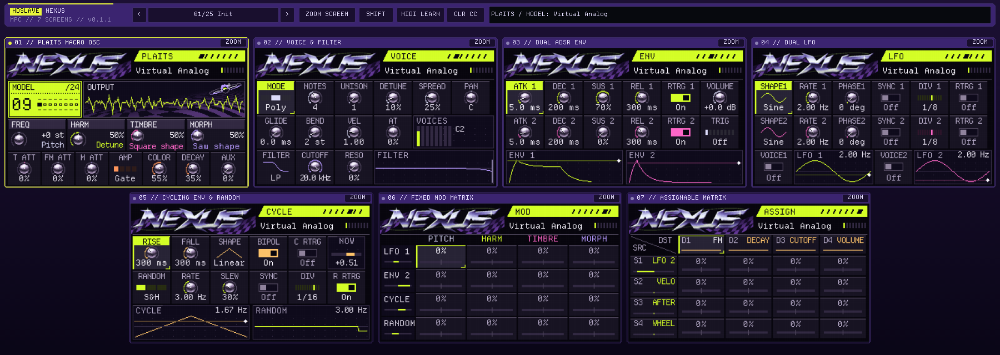</a>
    </td>
    <td>
      <h3><a href="https://github.com/hdslave/hdslave-Nexus-Synth">Nexus</a> &middot; <a href="https://github.com/hdslave/hdslave-Nexus-Synth/tree/main/mac-clap"><code>mac-clap/</code></a></h3>
      <p><strong>8-voice polyphonic Plaits macro-oscillator synth (7 screens, 134 params).</strong></p>
      <p>All 7 pages at once — Macro Osc (24 models + live scope), Voice &amp; Filter, Dual ADSR, Dual LFO, Cycling Env &amp; Random, Fixed Mod Matrix, and Assignable 4&times;4 Matrix with per-route on/off corner toggles.</p>
    </td>
  </tr>
  <tr>
    <td width="400" align="center">
      <a href="https://github.com/hdslave/hdslave-Reverie-Synth/tree/main/mac-clap">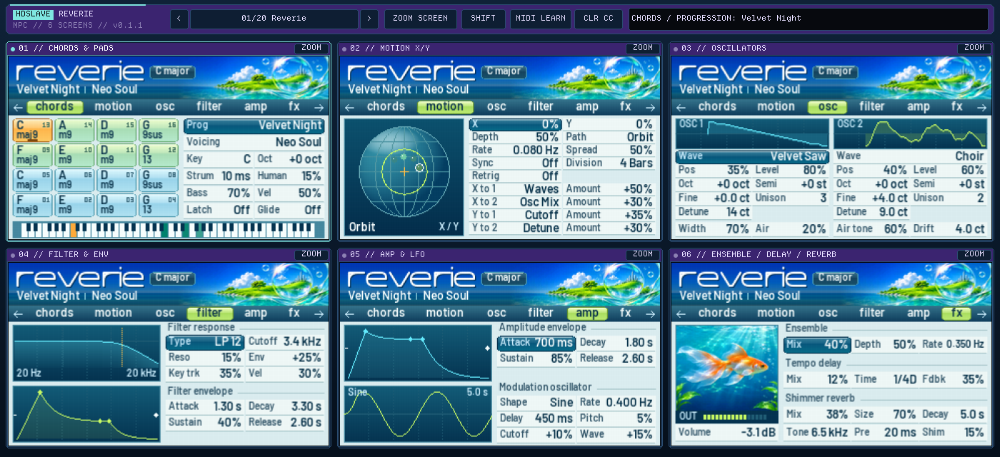</a>
    </td>
    <td>
      <h3><a href="https://github.com/hdslave/hdslave-Reverie-Synth">Reverie</a> &middot; <a href="https://github.com/hdslave/hdslave-Reverie-Synth/tree/main/mac-clap"><code>mac-clap/</code></a></h3>
      <p><strong>Chord-progression &amp; X/Y Motion pad synthesizer (6 screens, 80 params).</strong></p>
      <p>Play the 16 chord pads and mini keyboard directly, drag the 2D Motion X/Y glass orb, sculpt dual morphing wavetable oscillators, filter/amp envelopes, LFO, ensemble, delay, and shimmer reverb all on one panel.</p>
    </td>
  </tr>
  <tr>
    <td width="400" align="center">
      <a href="https://github.com/hdslave/hdslave-Necronomicon-Synth/tree/main/mac-clap">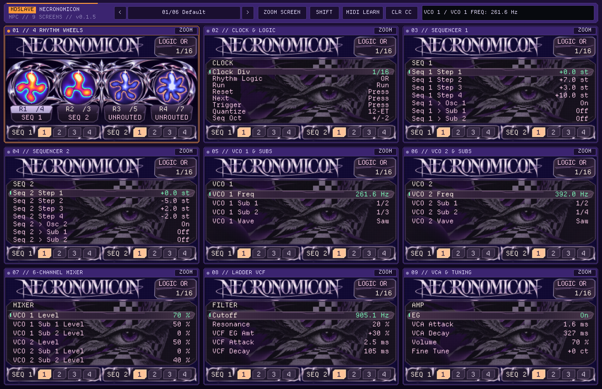</a>
    </td>
    <td>
      <h3><a href="https://github.com/hdslave/hdslave-Necronomicon-Synth">Necronomicon</a> &middot; <a href="https://github.com/hdslave/hdslave-Necronomicon-Synth/tree/main/mac-clap"><code>mac-clap/</code></a></h3>
      <p><strong>Polyrhythmic subharmonic synthesizer (9 screens, 58 params).</strong></p>
      <p>Drag the 4 stained-glass rhythm wheels to set divisions and click to cycle sequencer routing, alongside Clock &amp; Logic, Sequencer 1 &amp; 2, VCO 1 &amp; 2 Subs, 6-Channel Mixer, Ladder VCF, and VCA screens.</p>
    </td>
  </tr>
</table>

---

## Drums &amp; Percussion

<table>
  <tr>
    <td width="400" align="center">
      <a href="https://github.com/hdslave/hdslave-Foundry-Drum-Machine/tree/main/mac-clap">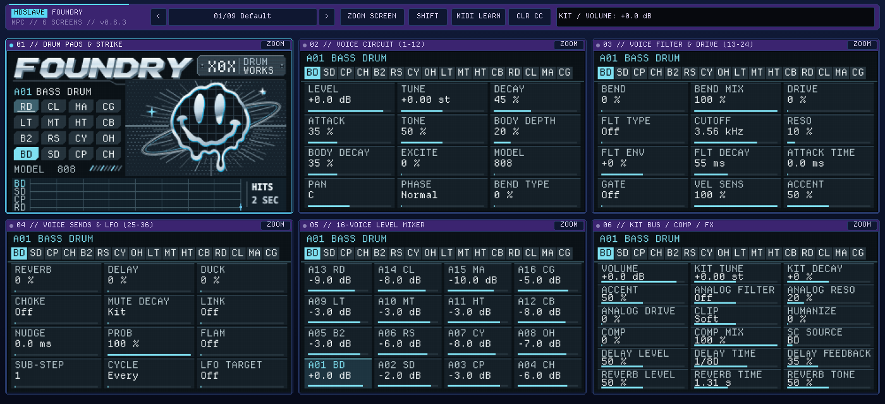</a>
    </td>
    <td>
      <h3><a href="https://github.com/hdslave/hdslave-Foundry-Drum-Machine">Foundry</a> &middot; <a href="https://github.com/hdslave/hdslave-Foundry-Drum-Machine/tree/main/mac-clap"><code>mac-clap/</code></a></h3>
      <p><strong>16-voice 808 / 909 / 606 drum machine (6 screens, 703 params).</strong></p>
      <p>Playable 16-pad grid with animated strike art and 4-lane hit timeline, all 36 per-voice shaping/filter/LFO controls across 3 tiles with a 16-pad quick bar, a 16-voice level mixer, and all 18 Kit Bus / Comp / Delay / Reverb cards.</p>
    </td>
  </tr>
  <tr>
    <td width="400" align="center">
      <a href="https://github.com/hdslave/hdslave-Anvil-Synth/tree/main/mac-clap">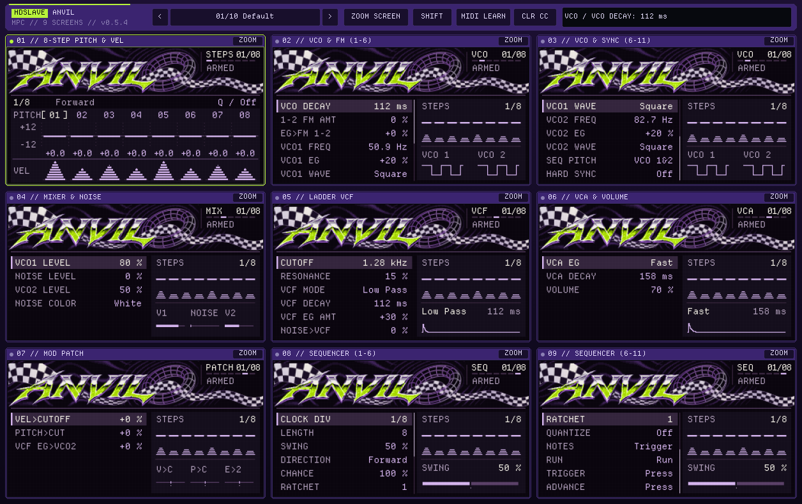</a>
    </td>
    <td>
      <h3><a href="https://github.com/hdslave/hdslave-Anvil-Synth">Anvil</a> &middot; <a href="https://github.com/hdslave/hdslave-Anvil-Synth/tree/main/mac-clap"><code>mac-clap/</code></a></h3>
      <p><strong>8-step analog-style percussion synthesizer (9 screens, 54 params).</strong></p>
      <p>Drag the 8-step pitch terraces and velocity pyramids directly (or click step badges to audition), alongside every VCO/FM/Sync, Mixer, Ladder VCF, VCA, Mod Patch, and Sequencer parameter on one screen.</p>
    </td>
  </tr>
  <tr>
    <td width="400" align="center">
      <a href="https://github.com/hdslave/hdslave-MoonBass-Synth/tree/main/mac-clap">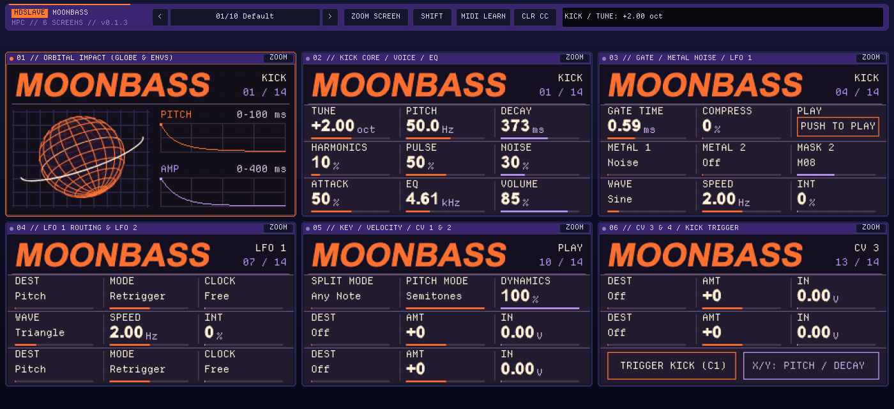</a>
    </td>
    <td>
      <h3><a href="https://github.com/hdslave/hdslave-MoonBass-Synth">MoonBass</a> &middot; <a href="https://github.com/hdslave/hdslave-MoonBass-Synth/tree/main/mac-clap"><code>mac-clap/</code></a></h3>
      <p><strong>Analog-style kick drum synthesizer (6 screens, 42 params).</strong></p>
      <p>Clickable Orbital Impact wireframe moon trigger with 2D interactive Pitch &amp; Amp envelope graphs, plus all 14 big pixel-digit parameter decks (Kick Core, Voice, EQ, Metal Noise, LFO 1 &amp; 2, Velocity/Key, and CV 1–4).</p>
    </td>
  </tr>
  <tr>
    <td width="400" align="center">
      <a href="https://github.com/hdslave/hdslave-Mystik-Synth/tree/main/mac-clap">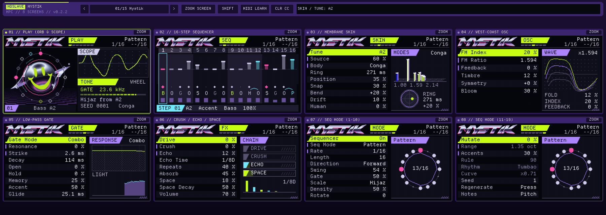</a>
    </td>
    <td>
      <h3><a href="https://github.com/hdslave/hdslave-Mystik-Synth">Mystik</a> &middot; <a href="https://github.com/hdslave/hdslave-Mystik-Synth/tree/main/mac-clap"><code>mac-clap/</code></a></h3>
      <p><strong>West-coast hand drum &amp; vactrol low-pass gate synth (8 screens, 116 params).</strong></p>
      <p>Vactrol orb &amp; live audition scope, full 16-step Pitch/Trig/Stroke/Chance lane editor, Membrane Skin, West-Coast Osc, Low-Pass Gate, Crush/Echo/Space FX, and all 19 Sequencer Mode parameters visible simultaneously.</p>
    </td>
  </tr>
</table>

---

## Effects

<table>
  <tr>
    <td width="400" align="center">
      <a href="https://github.com/hdslave/hdslave-Cortex-Filter/tree/main/mac-clap">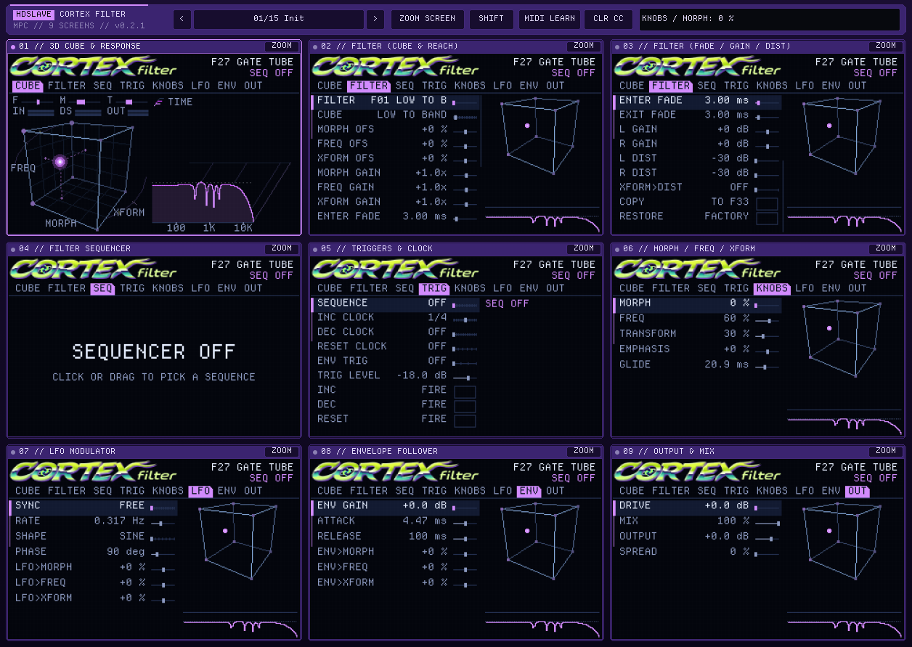</a>
    </td>
    <td>
      <h3><a href="https://github.com/hdslave/hdslave-Cortex-Filter">Cortex Filter</a> &middot; <a href="https://github.com/hdslave/hdslave-Cortex-Filter/tree/main/mac-clap"><code>mac-clap/</code></a></h3>
      <p><strong>Stereo 3D Z-plane morphing filter cube &amp; filter sequencer (9 screens, 46 params).</strong></p>
      <p>Drag directly on the 3D morphing cubes in 2D to steer Morph &amp; Freq, click the 3D frequency-response waterfall to switch between Time and Morph landscapes, and edit every Filter, Sequence, Trigger, LFO, Envelope, and Output control on one panel.</p>
    </td>
  </tr>
</table>

---

## Build &amp; Install All 11 Plug-ins

### macOS (Apple Silicon / Intel)

Requires Xcode Command Line Tools and CMake 3.20+ (Ninja optional):

```bash
./scripts/build-all-macos.sh
./scripts/install-all-macos.sh
```

`install-all-macos.sh` builds, ad-hoc signs, tests, and copies all 11 `.clap` bundles into `/Library/Audio/Plug-Ins/CLAP/` (pass `--user` for `~/Library/Audio/Plug-Ins/CLAP/`). Quit (`Cmd+Q`) and reopen **FL Studio**, then open **Options → Manage Plugins → Find installed plugins**.

To build or install a single plug-in directly from its submodule:

```bash
cd Reverie/mac-clap
./install-macos.sh
```

### Windows (x64)

Requires Visual Studio 2022 (C++ desktop workload) and CMake 3.20+:

```powershell
.\scripts\build-all-windows.ps1
```

Copy the built `.clap` files from each `<Plugin>\mac-clap\build\windows\clap\Release\` folder to `C:\Program Files\Common Files\CLAP\`.

## Keeping It Current

Submodule folders stay at their pinned commits until updated. Run `tools/update.sh` to advance every plug-in folder to the latest commit on `main` and commit the updated pins; then `git push` to publish.

## Trademarks &amp; Licences

- **CLAP SDK**: MIT Licence.
- **Departure Mono** (`mac-clap/licenses/OFL-departure-mono.txt`): SIL Open Font Licence 1.1.
- **Nexus DSP** (`third_party/eurorack`): MIT Licence (Émilie Gillet / Mutable Instruments Plaits code).
- Product names mentioned here are trademarks of their respective owners (Roland, Moog Music, Behringer, Jomox, Elektron, Korg, Pioneer DJ / AlphaTheta, E-mu, Rossum Electro-Music, Mutable Instruments, Image-Line, inMusic Brands). These projects are not affiliated with or endorsed by any of them.
